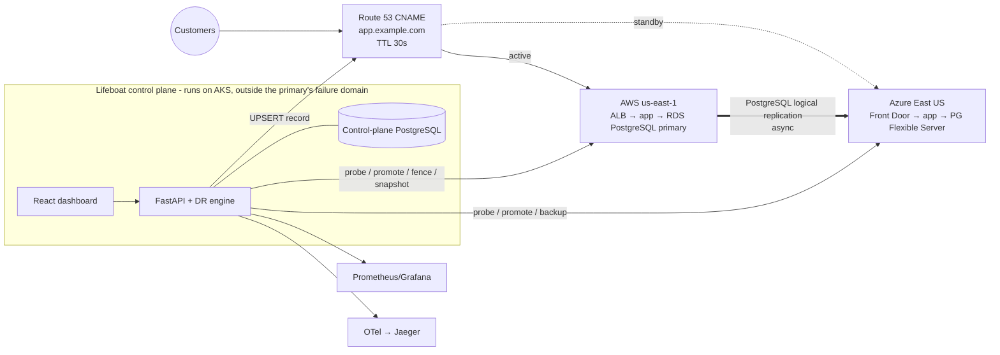
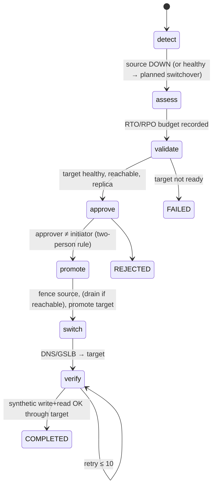

# Architecture

## 1. Context



The control plane is deliberately **not** deployed only in the region it protects. The recommended home is the
AKS cluster on the standby side, or a third location. The AKS overlay is provided for this.

## 2. Clean architecture

```
api (HTTP, auth, RBAC)  →  engine (DR logic, pure where possible)  →  providers (interfaces)
                                                                        ├── local  (simulation)
                                                                        ├── aws    (boto3)
                                                                        └── azure  (azure-mgmt + PG)
```

- `providers/base.py` defines `RegionProvider` (probe, db_status, promote, fence, demote_to_replica,
  catch_up_from, resync_from, create_backup, verify_backup, synthetic_transaction, restart_service) and
  `TrafficManager` (active_region, switch_to).
- `engine/` depends only on these interfaces. Readiness, planning and the copilot are pure functions over an
  immutable `Snapshot`, which makes them trivially unit-testable.
- `engine/runtime.py` is the composition root. It wires the providers for `local` or `cloud` mode and owns the
  tick loop.

## 3. The engine tick (1 s)

1. *(local mode)* The synthetic workload writes one transaction through the traffic manager to the active region.
   Replication ships transactions older than the configured delay (2 s) to the replica.
2. **Monitor** probes each region's app, database and network, applying hysteresis:
   `UP → DEGRADED` on the first failure, `→ DOWN` at 3 consecutive failures (opening an incident),
   `DOWN → UP` after 2 consecutive successes (resolving incidents). It also computes replication lag from the
   newest committed transaction on each side. Three ticks over budget open a `replication_lag` incident.
3. **React**: a `service_failure` on the active region triggers self-healing (restart) first. Regional failures
   auto-initiate a failover run when `auto_initiate_failover` is set and the standby is healthy.
4. **Orchestrator** advances the active run as far as it can.
5. **Game days** advance their phase machines.
6. Prometheus gauges are updated.

The monitor **never reads the fault table**. Faults are only visible through probe results, exactly as with
real clouds, so detection is genuinely exercised.

### Leader election

Each API replica tries `pg_try_advisory_lock(727000)` on a dedicated connection, and only the holder ticks. If
the leader dies, its connection drops, the lock is released, and another replica takes over within one tick.
Mutations from any replica serialise per process with an `RLock` and across replicas with `SELECT … FOR UPDATE`
on the run row. Audit appends use `pg_advisory_xact_lock` so the hash chain stays linear.

## 4. Recovery state machines



Failback is `precheck → resync → validate (waits for lag ≤ budget) → approve → promote (drain + role swap) →
switch → verify`. Steps return `ok | wait | fail`. A `wait` parks the run until the next tick (approval,
catch-up, verification retries) with per-step attempt limits. Any exception fails the run and never crashes the
engine.

**Split-brain protection.** Promotion first *fences* the old primary by revoking its write lease. When a
crashed region returns, its database comes back `FENCED` (read-only) and **cannot be promoted** until it has been
resynced. The resync discards the divergent writes it accepted before the crash, and their count is recorded.

## 5. Measurement methodology

| Metric | Definition |
|---|---|
| Time to detect | first failed probe → incident opened (threshold crossed) |
| Time to decide | detection → approval |
| Time to execute | approval → verified recovery |
| **RTO** (unplanned) | first failed probe → verified synthetic transaction on the new primary |
| **RTO** (planned) | write freeze (drain start) → verified recovery |
| **RPO** | commit time of last *client-acknowledged* write − commit time of last write applied on the promoted replica |
| Data loss | acknowledged sequence numbers absent from the promoted replica |
| Customer impact | first failed synthetic write → first success (or verified recovery) |

RPO uses the **client's acknowledgement ledger**, not the dead primary, because the primary is unreachable at
failover time. The failback resync then independently counts divergent rows on the recovered primary. In
every test and demo run the two numbers match, which cross-validates the measurement.

## 6. Readiness score

"Could we survive losing the *currently active* region right now?" There are five weighted components:

| Component | Weight | Full marks when |
|---|---|---|
| Standby health | 25 | standby UP and its DB is a replica |
| Replication & RPO exposure | 25 | exposure ≤ lag budget |
| Backup integrity | 20 | newest verified backup younger than policy max age |
| DR test cadence | 15 | successful failover / game day in the last 30 days |
| Proven RTO | 15 | mean of last 5 measured RTOs ≤ target |

Blockers (standby down, RPO breach, fenced standby, active region down, run in progress) force the status out of
`ready` regardless of score. After a failover the protected region becomes Azure, and readiness drops until AWS
is resynced. That is intentional and correct.

## 7. Security model

- **AuthN**: bcrypt (cost 12) passwords and HS256 JWTs (60 min) with a secret from the environment. In `prod`
  the process refuses to start without one. Login is rate limited per user and per IP, and timing is equalised
  for unknown users.
- **AuthZ**: permission-based RBAC. The role is re-read from the database on every request, so demotions and
  disables apply immediately. Denials are audited.

  | Role | Can |
  |---|---|
  | viewer | read everything except audit, use copilot |
  | operator | + inject faults, backups, initiate runs, game days, remediate |
  | approver | + approve/reject runs, read audit; cannot inject faults |
  | admin | everything, including policy and users |

- **Two-person rule**: the initiator of a run cannot approve it. Game-day pre-approval requires the
  approver/admin role and is audited as such.
- **Audit**: append-only, with each row storing `sha256(prev_hash ‖ canonical(entry))`. `GET /audit/verify`
  recomputes the chain, and modifying any row is detected (covered by a test).
- **Secrets**: nothing is hardcoded. `.env` is generated with random values and git-ignored. Kubernetes uses
  External Secrets (AWS Secrets Manager / Azure Key Vault). RDS uses `manage_master_user_password`, and the Azure
  PG password is generated by Terraform into Key Vault.
- **Copilot guardrails** (enforced in code): read-only tools, tool list filtered by role, unknown tools and
  actions rejected, a bounded tool loop (6 turns), and tool output treated as data. Actions are returned as
  *proposals* that the human executes through the normal RBAC, approval and audit path.
- **Containers / K8s**: non-root UID, read-only root filesystem, all capabilities dropped, seccomp
  RuntimeDefault, restricted Pod Security, default-deny NetworkPolicies, PDB, and topology spread.

## 8. Observability

- `/metrics`: region status, probe latency histogram, replication lag, RPO exposure, readiness, active region,
  backup age, run counters, last RTO/RPO, engine tick duration, and HTTP requests.
- Alert rules: active region down, standby down, lag over budget, RPO exposure over target, low readiness, stale
  backups, missed RTO, and engine stalled.
- Tracing: FastAPI auto-instrumentation plus manual spans per recovery step (`failover.advance → step.promote`
  …), exported via OTLP when `LIFEBOAT_OTEL_EXPORTER_OTLP_ENDPOINT` is set.
- `/readyz` fails if the database is unreachable or the engine has not ticked for 10 intervals.

## 9. Cloud adapters

| Capability | AWS | Azure |
|---|---|---|
| App probe | HTTPS `/healthz` via ALB | HTTPS `/healthz` via Front Door |
| DB control plane | `rds:DescribeDBInstances` | Flexible Server `servers.get` |
| Data plane / lag | heartbeat table + `pg_subscription` (pgrepl.py) | same |
| Promote | `PromoteReadReplica` if a physical replica, then disable subscription + lift read-only | disable subscription + lift read-only |
| Fence | `default_transaction_read_only=on` + terminate sessions; deferred if unreachable | same |
| Traffic | Route 53 CNAME UPSERT (TTL 30 s) | – (DNS owned by Route 53) |
| Backups | RDS snapshot, verified status/encryption/identity | on-demand Flexible Server backup |

Cross-cloud replication is PostgreSQL **logical** replication (publication `lifeboat_pub` → subscription
`lifeboat_sub`), because the two managed services cannot replicate physically to each other.

## 10. Trade-offs and limitations

- **Async replication ⇒ non-zero RPO** on unplanned failover. That is the price of not putting cross-cloud
  latency on every commit. Planned switchovers drain first and lose nothing.
- **DNS-based steering** adds client TTL to RTO, which is bounded by TTL 30 s. An anycast GSLB would remove this
  at extra cost.
- **Human approval dominates RTO** in practice, and the reports say so. The policy can pre-approve confirmed
  full-region outages.
- **Cloud adapters are unverified against live accounts.** They are tested with moto and mocks only. Logical
  replication setup (publication, subscription, network path) is a one-time bootstrap that Terraform prepares but
  does not fully automate. Service restart in cloud mode is delegated to the orchestrator (ECS/EKS/AKS rollout).
- **Single control-plane database**: the control plane's own HA comes from the managed PostgreSQL's HA. Losing
  it pauses automation but not the protected application.
